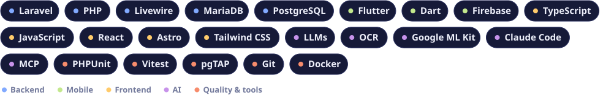

  

### Hi, I'm Fran

Full stack Software Developer in Spain. I build a SaaS TMS for transport companies in Norway: the web platform in Laravel and the drivers' app in Flutter, with AI and OCR in production.

[Portfolio](https://franbasguil.netlify.app/en/) · [Versión en español](https://franbasguil.netlify.app/es/) · [LinkedIn](https://www.linkedin.com/in/franbasguil) · [Email](mailto:franbasguil@gmail.com)

#### Personal projects

- **[YourFavs](https://github.com/FranBas6/YourFavs)** ([demo](https://yourfavs.netlify.app)): track films and TV series episode by episode and share them with friends.
- **[OnMyMind](https://github.com/FranBas6/OnMyMind)** ([demo](https://onmymind.pages.dev/)): offline-first lists for tasks, shopping and notes, shared in real time.

#### Stack

