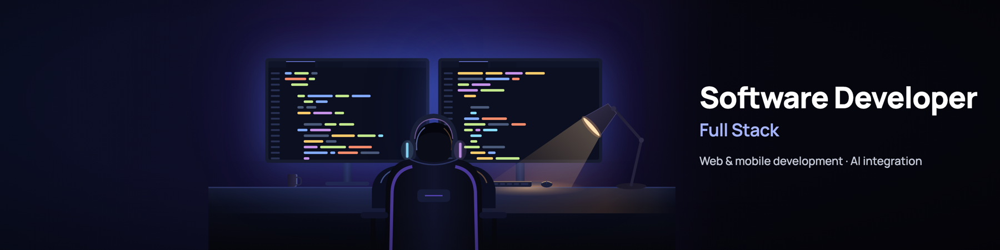

  

### Hi, I'm Fran

Full stack Software Developer based in Spain, working on web and mobile with Laravel and Flutter.

**Portfolio:** [franbasguil.netlify.app](https://franbasguil.netlify.app/en/) · [versión en español](https://franbasguil.netlify.app/es/)

#### What I do

I work at a company that builds a transport management system (TMS) for transport companies in Norway, sold as SaaS: a web platform to plan and manage the work, and a mobile app for the drivers. I work on both, building features from start to finish, from the backend in Laravel to the Flutter app, and bringing AI and OCR into the product.

#### Personal projects

| Project | What it is | Stack |
| --- | --- | --- |
| **[YourFavs](https://github.com/FranBas6/YourFavs)** · [demo](https://yourfavs.netlify.app) | Web app to track films and TV series episode by episode, find what to watch next and share it with friends. | Astro · TypeScript · Supabase · TMDB API |
| **[OnMyMind](https://github.com/FranBas6/OnMyMind)** · [demo](https://onmymind.pages.dev/) | Offline-first list app to get everything out of your head (tasks, shopping, notes and events), with lists shared in real time. | React · TypeScript · TanStack Query · Supabase |

#### Stack

**Backend:** Laravel · PHP · Livewire · MariaDB · PostgreSQL 
**Mobile:** Flutter · Dart · Firebase 
**Frontend:** TypeScript · JavaScript · React · Astro · Tailwind CSS 
**AI:** LLM integration · OCR · Google ML Kit · AI agents (Claude Code, MCP) 
**Quality and tools:** PHPUnit · Vitest · pgTAP · Git · Docker

#### Contact

[franbasguil@gmail.com](mailto:franbasguil@gmail.com) · [LinkedIn](https://www.linkedin.com/in/franbasguil) · [Portfolio](https://franbasguil.netlify.app/en/)
